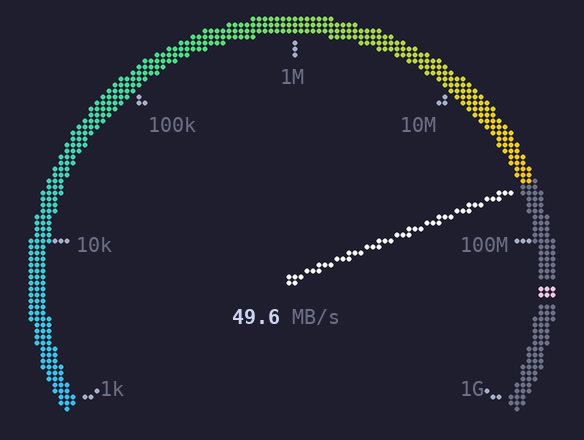
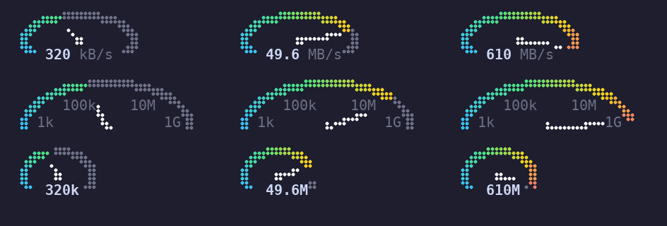
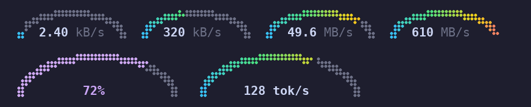
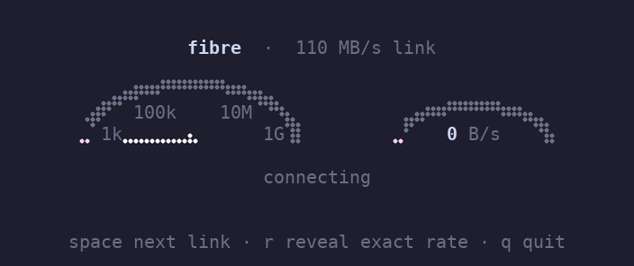

# tui-gizmos

Graphical gizmos for [Ratatui](https://ratatui.rs): small, stateless widgets
that turn numbers into something you can read at a glance.


| Gizmo | What it shows |
|-------|---------------|
| `Speedometer` | Braille dial with needle, gradient arc, ticks, peak marker and readout |
| `ArcSpeedometer` | Two-row lit arc with the readout inside it, no needle |
| `MiniSpeedometer` | Three-line dial with a readout or labelled gradations |

Each gizmo shows one thing. A speedometer displays a speed and nothing
else — no captions, file names or progress — so it composes with whatever
else you put around it (a progress bar underneath, a title in a `Block`).

## Speedometer

Replaces text like `49.6MB/s` with a dial. Once there's room, every tick is
labelled, so the rough speed reads off the dial at a glance. The needle
stops just short of the label it points at, so labels are never covered.
Often that's precision enough — `.no_readout()` drops the readout entirely.



```rust
use tui_gizmos::Speedometer;

// Network rate: log dial from 1 kB/s to 1 GB/s, ticks labelled 1k … 1G.
frame.render_widget(Speedometer::bytes_per_sec(rate).peak(peak), area);

// Anything else: pick a range, a sweep and a readout.
frame.render_widget(
    Speedometer::new(cpu).sweep(180.0).readout(format!("{cpu:.0}%")).fill_color(Color::Magenta),
    area,
);
```

The dial fits itself to the area it's given: around 12×4 it's a small dial
with a readout, at 24×8 it gains tick marks, and from about 40×14 the ticks
get labels. Too small for a dial, it falls back to the readout text.

| Option | Default |
|--------|---------|
| `range(min, max)` / `scale(Scale::Log)` | `0..100`, linear |
| `sweep(degrees)` | 240° (car dashboard); 180° for a half dial |
| `ticks(n)` / `thickness(dots)` | 5 / grows with size |
| `tick_labels(fn)` | off (`bytes_per_sec` uses `format::si`: `1k` … `1G`) |
| `fill(Fill::Gradient(..))` / `fill_color(c)` | cyan → green → yellow → red |
| `peak(v)` | none |
| `readout(..)` / `readout_format(fn)` / `no_readout()` | none (`bytes_per_sec` formats for you) |
| `readout_style(..)` / `unit_style(..)` | bold number / dark gray unit and labels |
| `block(Block)` / `style(..)` | none |

## MiniSpeedometer

Three lines tall, in one of two styles: a precise readout set into the dial
(top row, 14 columns), or with `.no_readout()`, labelled gradations (middle
row, 21 columns) — roughly "between 10M and 1G", which is usually all you
need. The bottom row is the compact variant below.



```rust
MiniSpeedometer::bytes_per_sec(rate).peak(peak)                // readout
MiniSpeedometer::bytes_per_sec(rate).peak(peak).no_readout()   // gradations
MiniSpeedometer::bytes_per_sec(rate).no_readout().ticks(6)     // every decade, at 4 rows
```

Each style is designed for the size rather than shrunk:

- **Readout:** the needle and hub sit in the top two rows. The 240° arc
  leaves an opening at the bottom where the readout goes, so text and dial
  share columns.
- **Gradations:** a 180° dial fills all three rows, with tick values just
  inside the arc. Tick *marks* are left off because at this size they share
  cells with the arc and break it up; the labels mark the positions.

Both are ellipses (`aspect`: 2.0 with a readout, 1.8 without) to make room
for text and give the needle travel in 12 dots of height; `sweep` and
`aspect` can be overridden.

For a narrower readout, a shorter format and a rounder dial fit in 10
columns:

```rust
MiniSpeedometer::bytes_per_sec(rate).readout_format(format::si).aspect(1.3)
```

## ArcSpeedometer

No needle: the value is how far the arc is lit, and with the hub gone the
readout moves inside the arc. Two lines, 15 columns:



```rust
frame.render_widget(ArcSpeedometer::bytes_per_sec(rate).peak(peak), area); // 2 rows
frame.render_widget(ArcSpeedometer::new(cpu).readout(format!("{cpu:.0}%")), area);
```

A flat-bottomed 180° arc fills both rows, and the readout is centred on the
bottom row between its sides. The default `aspect` of 2.0 is the narrowest
that keeps every `bytes_per_sec` readout clear of the arc. Taller areas
scale the arc up; at one row it's just the readout. It shares the colour,
scale, range, peak and readout options of the other speedometers.

## Motion

Widgets are stateless, so a raw signal makes a jittery needle. Keep a
`Damped` (exponential easing) and a `PeakHold` (hold-then-decay peak) in your
app state and feed them each frame:

```rust
let rate = app.rate.update(sample, dt);   // Damped::new(0.0, Duration::from_millis(250))
let peak = app.peak.update(rate, dt);     // PeakHold::new(Duration::from_secs(2), 0.6)
```

## Examples



```sh
cargo run --example speedometer   # dashboard: log, half-dial, 300° and size ladder
cargo run --example download      # inline mini dials, readout vs gradations
cargo run --example simulate      # realistic download behaviour: graduated dial + arc
```

The images in this README are rendered from the widgets themselves:

```sh
GIZMO_RECORD=assets cargo test --test record -- --ignored
GIZMO_RECORD=assets cargo test --example simulate -- --ignored
uv run assets/render.py assets/*.frames   # needs DejaVu Sans Mono
```

## Design notes

- Built on Ratatui only (`default-features = false`); works with any backend.
- Drawing happens in braille dot space, where dots are nearly square, so
  circles come out round. A small layered canvas (`src/braille.rs`) resolves
  per-cell colour conflicts by showing only the topmost layer, which keeps the
  fill/track boundary accurate to the dot. New gizmos should reuse it.
- Dial painting (`src/dial.rs`) and the shared builder methods
  (`src/macros.rs`) are shared by all the speedometers.
