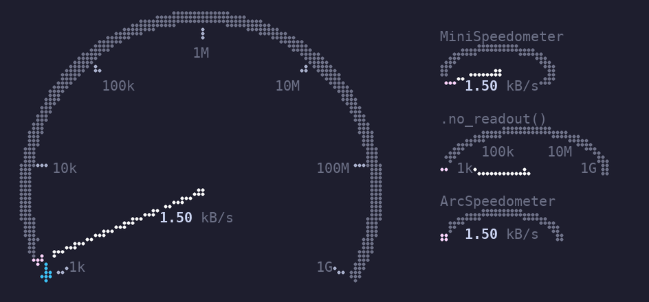
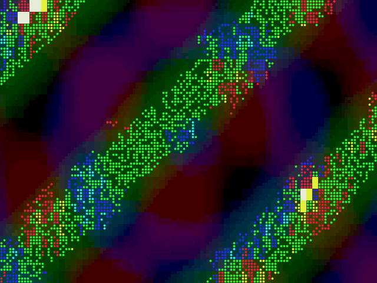

# tui-gizmos

Goodies for [Ratatui](https://ratatui.rs). Each one is its own crate with its
own README, and they don't depend on each other.

| Crate | What it is |
|-------|------------|
| [`tui-gizmos`](gizmos/) | Small, stateless widgets that turn numbers into something you can read at a glance: braille speedometers and friends |
| [`tui-stipple`](stipple/) | GIFs and video as braille stipple art: a widget and a terminal player |

[](gizmos/)

[](stipple/)

```sh
cargo run -p tui-gizmos --example simulate        # a dial following a simulated download
cargo run -p tui-stipple --release -- loop.gif    # play a GIF or video (needs ffmpeg)
```

MIT licensed; see [LICENSE](LICENSE).
