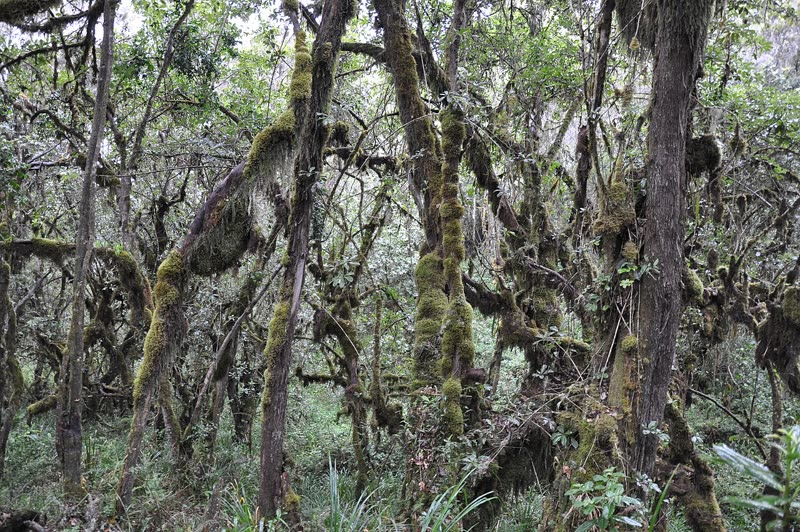
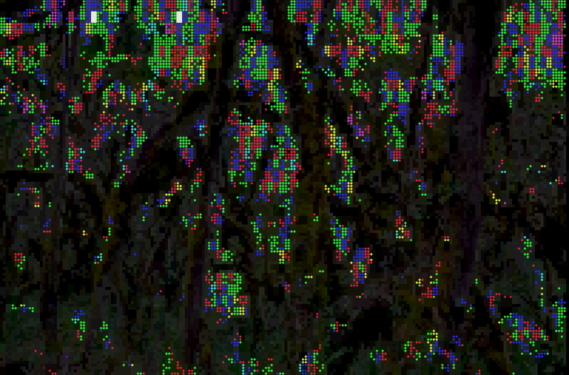
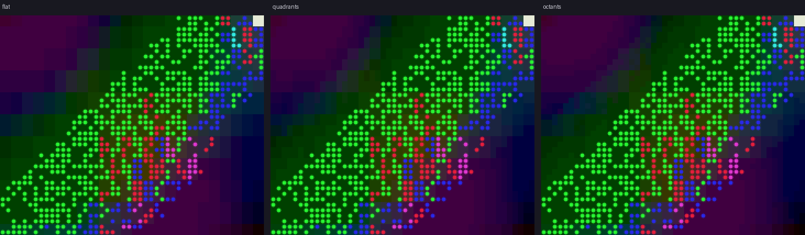

# tui-stipple

GIFs and video as braille stipple art in the terminal: a
[Ratatui](https://ratatui.rs) widget and a player.


This isn't a faithful video player. Every picture is pushed into one
texture: a dark posterised base with a screen of pure red, green and blue
braille dots over the bright parts. Each frame is dithered afresh, so moving
pictures shimmer while stills hold still. It renders any content, but it
always looks like itself.

Nothing is added that isn't in the picture unless you ask for it: magenta
dashes and red drips (`--accents`), glitches (`--glitch`) and a shimmer that
keeps going over still pictures (`--shimmer`) are all off by default.

## Play something

```sh
cargo run -p tui-stipple --release -- loop.gif
# or install it: cargo install --path stipple
```

It plays anything `ffmpeg` can decode (GIF, MP4, WebM, still images), so
`ffmpeg` needs to be on your `PATH`. Short files loop from memory.

| Key | |
|-----|-|
| `space` | pause everything |
| `s` | shimmer: re-deal the dots 15 times a second, even on a still |
| `a` | accents: magenta dashes and red drips |
| `g` | glitches |
| `d` | background detail: flat → halves → quadrants → octants |
| `f` | fit: contain → cover → stretch |
| `?` | help |
| `q` | quit |

Each key shows what it changed in the bottom-left corner. The same switches
are options (`--accents`, `--glitch <rate>`, `--shimmer <hz>`, `--detail`,
`--fit`), along with `--fps` and `--start <seconds>`; `stipple --help` lists
them all.

## How a picture becomes stipple

<p>
  
  
</p>

Each terminal cell is one braille character, which has a background colour
and a foreground colour with a 2×4 grid of dots. That maps onto the layers
of the texture:

| Layer | Comes from | Drawn as |
|-------|------------|----------|
| Base | the whole picture, darkened and posterised into hard-edged steps | cell backgrounds, split with block glyphs where a cell straddles an edge |
| Dots | the brightest third or so of the picture | braille dots; each dot takes one pure primary, picked in proportion to the picture's red, green and blue, so colour reads as speckle rather than a blend |
| Clip | near-white | solid blocks |
| Accents (optional) | dark areas with something in them; warm colours | short magenta `╴` `╶`; dim red `│` running down |
| Glitches (optional) | chance | bright bars, smeared diagonal streaks, torn rows, frozen blocks |

The dots fill whole regions rather than speckling every highlight: the
picture's brightness is lightly blurred, and dots go wherever it is above a
threshold chosen so that a set share of the picture gets them. That keeps
the texture consistent from a dim forest to a flat neon GIF.

## Background detail



Cells without marks can split their background into two colours with block
glyphs, for detail finer than a cell:

| `Detail` | Glyphs | Works in |
|----------|--------|----------|
| `Flat` | none | everything |
| `Halves` | `▀` | everything |
| `Quadrants` (widget default) | `▘ ▚ ▙ …` | nearly every terminal |
| `Octants` | Unicode 16 octants, a 2×4 grid like braille | terminals that draw them, such as Ghostty, or with a font that has them |

The player picks octants in Ghostty and quadrants elsewhere; `--detail
octants` turns them on anywhere.

## Use the widget

```rust
use tui_stipple::{AutoLevels, Look, Picture, Stipple};

// In your app state:
let mut levels = AutoLevels::default();

// For each new frame, with `rgb` holding width × height × 3 bytes:
let picture = Picture::new(width, height, &rgb).expect("RGB frame");
let exposure = levels.update(&picture, &Look::DEFAULT, dt);
frame.render_widget(Stipple::new(picture).levels(exposure).seed(frame_number), area);
```

`Stipple` is stateless. The same `seed` always gives the same dots, so use
a new one for each new frame and the same one while the picture holds
still. `AutoLevels` smooths exposure so video doesn't pump. For glitches,
keep a `Glitch` and call `glitch.apply(area, frame.buffer_mut(), dt)` after
rendering.

Every parameter lives in `Look`. Start from `Look::DEFAULT` (or
`Look::ACCENTED`, which adds the dashes and drips) and override fields, e.g.
`Look { dot_coverage: 0.2, ..Look::DEFAULT }` for sparser dots. The main
ones:

| Field | What it does |
|-------|--------------|
| `dot_coverage` | share of the picture that gets dots (0.35) |
| `dot_min`, `dot_max` | dot density just above the threshold and at full brightness |
| `base_gain`, `base_levels` | how bright the background gets, and how many steps it has |
| `palette` | the eight dot colours, indexed by red = 1, green = 2, blue = 4 |
| `dash_density`, `drip_density` | how many dashes and drips (0 unless you use `ACCENTED`) |
| `clip` | luminance at which a cell becomes a solid block |

Rendering a 250×70 terminal takes about 4 ms (`cargo run -p tui-stipple
--release --example bench`).

## Calibration

The default look was tuned against a glitch-art loop of a jungle, measured
frame by frame. In that loop, dots are about 2×2 pixels on a 4 pixel pitch,
the same proportions as braille. Their colours are green 49%, red 18%, blue
14% and cyan 11%, and four in five are pure primaries. Only about half the
dots are still lit in the next frame, so the dither is redone every frame.
Nine tenths of the base is darker than 17% grey. The renderer was then
checked against photos, video, abstract GIFs and ffmpeg's synthetic sources,
so that each one comes out in the same texture.

Only how the loop draws a picture went into the default. What it draws (its
green datamosh flashes, red hanging vines and magenta noise) belongs to
that video, so the look-alikes of those are optional extras.

`stipple --dump frames.txt --size 100x40 <file>` writes rendered frames as
text, and `tools/raster.py` turns them into PNG or GIF the way a terminal
draws them. `tools/readme-assets.sh` regenerates the images here.

Forest photo: [Jorge Láscar](https://commons.wikimedia.org/wiki/File:Lascar_Exuberant_vegetation_(Montane_rainforests_biome)_(4460864208).jpg),
CC BY 2.0, downscaled.
